# Sortify ♻️

**Smart Waste Management for Tunisia**

Sortify is an Android mobile application designed to help users sort everyday waste more responsibly. Users enter the name of an item, view its suggested waste category and disposal instructions, and learn about its environmental impact. The app also encourages responsible habits through points, progress tracking, and achievement badges.

> **Project status:** Academic / educational mobile application project.

## Overview

Sortify focuses on making waste sorting easier to understand and more engaging. Its interface uses a green environmental theme and presents sorting guidance in a simple format.

The waste information currently covers organic waste, paper and cardboard, plastic, glass, metal and aluminium, electronic waste, textiles, hazardous waste, construction materials, and miscellaneous materials.

The application is oriented toward Tunisia. Disposal options should always be checked against the collection and recycling services available in the user's municipality.

## Main features

- **Welcome and account screens:** introductory screen, login, and registration interfaces.
- **Waste classification:** enter an item's name to retrieve its suggested category.
- **Disposal guidance:** practical instructions explaining how to prepare or dispose of the item.
- **Environmental information:** a short explanation of why correct sorting matters.
- **Points and progress:** earn 10 points when an item is classified and recorded.
- **Achievement badges:** progress toward Beginner, Eco-Learner, and Recycling Hero levels.
- **Impact dashboard:** view sorting activity, accumulated points, and badge progress.
- **Share progress:** share a short message about the user's Sortify progress.

## Application workflow

1. The user opens Sortify and reaches the welcome screen.
2. The user logs in or creates an account.
3. The dashboard displays sorting statistics, points, and recent activity.
4. The user chooses **Sort an item** and enters an item's name.
5. Sortify displays the item's name, suggested waste category, disposal instructions, and environmental impact.
6. The user earns 10 points for the classified item.
7. The user can sort another item, return to the dashboard, or open the impact/progress screen.
8. The impact screen displays points, progress toward the next badge, earned badges, and a share option.

## Screenshots

The screenshots below were extracted from the six-page project document supplied with the project. They are stored in the repository's `screenshots/` folder.

### 1. Welcome screen

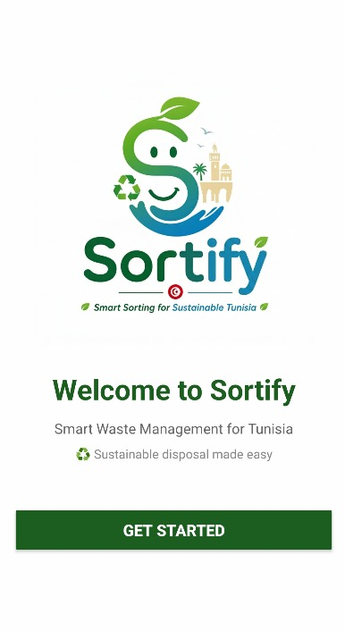

### 2. Login screen

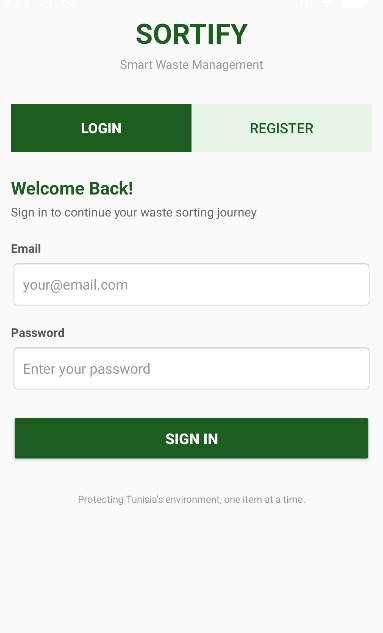

### 3. Registration screen

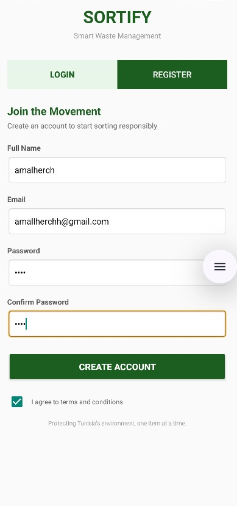

### 4. Main dashboard

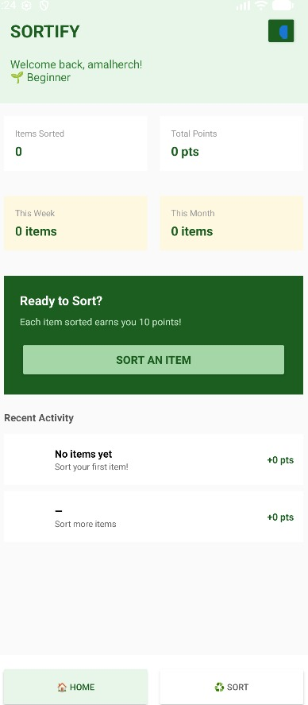

### 5. Enter an item to sort

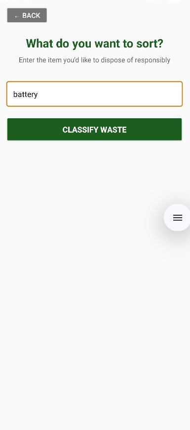

### 6. Waste classification result

This example shows a battery classified as hazardous electronic waste, with disposal instructions and environmental information.

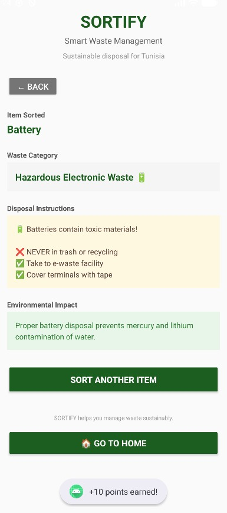

### 7. User impact dashboard

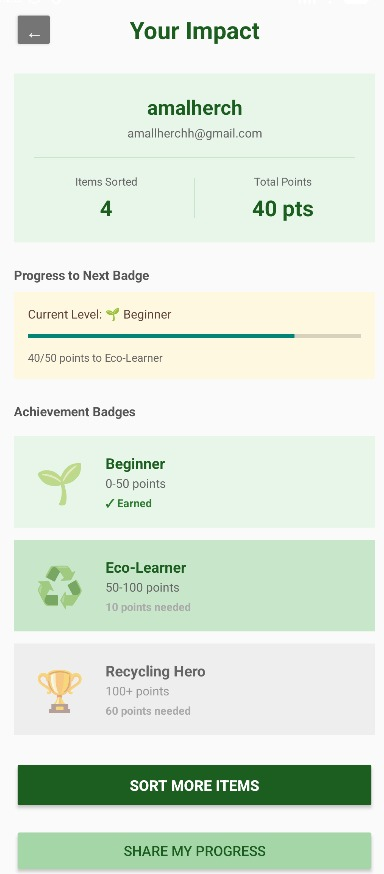

### 8. Example: leather item

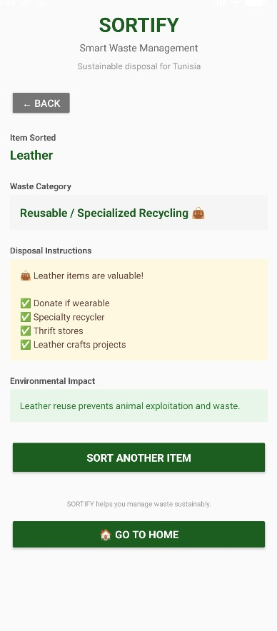

### 9. Example: ceramic plate

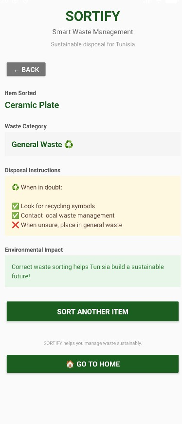

### 10. Badge progress

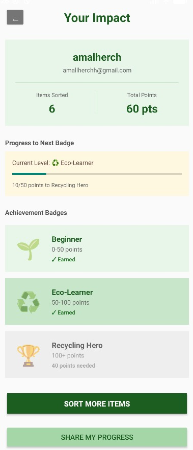

### 11. Share progress

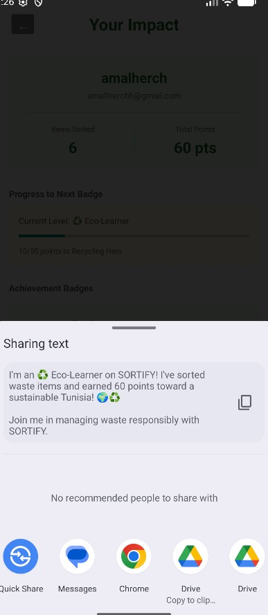

## Technology

Based on the supplied project files and code:

- **Platform:** Android
- **Language:** Java
- **Build system:** Gradle
- **Gradle scripts:** Kotlin DSL (`.gradle.kts`)
- **UI:** Android layouts and AndroidX / AppCompat
- **Application package:** `com.example.sortify`

The supplied `SortResultActivity` uses a `HashMap` of waste-item information and a `PreferencesManager` to award points.

## Project structure

The Android Studio project root contains the following main elements:

```text
sortify/
├── app/
│   └── src/
│       └── main/
│           ├── java/com/example/sortify/
│           ├── res/
│           └── AndroidManifest.xml
├── gradle/
├── build.gradle.kts
├── settings.gradle.kts
├── gradlew
├── gradlew.bat
├── .gitignore
├── README.md
└── screenshots/
    ├── screen-01.jpg
    ├── screen-02.jpg
    ├── screen-03.jpg
    ├── screen-04.jpg
    ├── screen-05.jpg
    ├── screen-06.jpg
    ├── screen-07.jpg
    ├── screen-08.jpg
    ├── screen-09.jpg
    ├── screen-10.jpg
    └── screen-11.jpg
```

Your actual `app/src/main/` folders may contain additional files and packages. Keep the existing Android Studio source files; the tree above is a guide to the repository layout, not a replacement for your project.

## Run the project

1. Install **Android Studio**.
2. Clone or download this repository.
3. In Android Studio, select **Open** and choose the `sortify` project folder (the folder containing `settings.gradle.kts`).
4. Allow Gradle to sync and download the required dependencies.
5. Connect an Android device with USB debugging enabled, or start an Android emulator.
6. Select the `app` run configuration and press **Run**.

If Gradle sync fails, check that the Android Gradle Plugin and SDK versions required by the project are installed. Add the exact minimum Android version and SDK versions after checking the app-level Gradle configuration.

## How waste classification works

In the supplied `SortResultActivity` code, the app looks up the entered item name in a predefined `HashMap`. Each entry contains a category, emoji, disposal instructions, and an environmental-impact explanation.

For example, an item entered as `battery` is mapped to **Hazardous Electronic Waste** and displays battery-specific disposal guidance. If the entered name does not match an entry, the app displays a general-waste fallback message.

This implementation is a predefined text-based lookup. It should not be described as AI image recognition or camera-based detection unless those capabilities are implemented elsewhere in the project.

## Possible future improvements

- Add autocomplete and more flexible item-name matching.
- Add Arabic and French translations to support more users in Tunisia.
- Validate disposal instructions against local municipal recycling services.
- Add camera-based item recognition if a suitable model and dataset are integrated.
- Add more detailed sorting history and statistics.
- Add tests for item lookup, points, and badge progression.

## Notes

- The screenshots are illustrative examples from the supplied project document. The displayed account name and email may be personal information; replace or blur them before publishing if they belong to a real person.
- Do not commit passwords, API keys, signing credentials, `local.properties`, or other machine-specific/private configuration.
- Add a license only if you intend to grant others permission to reuse or modify the project.
